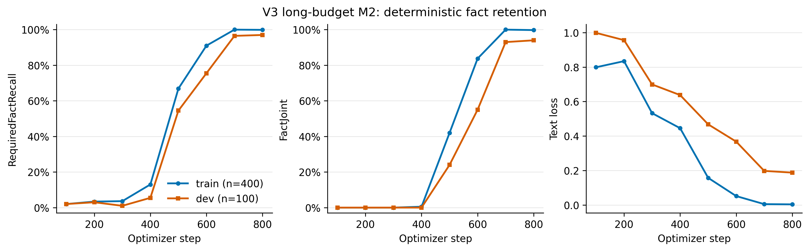

# V3 long-budget M2 diagnostic

## Decision

V3 reached `train FactJoint = 99.75%` and `dev FactJoint = 94.00%` at step 800. It
therefore meets the pre-registered first decision condition (`train >= 95%`,
`dev >= 90%`): the 300-step budget was an important cause of the V2 failure. A
full downstream evaluation is the next experiment; it was intentionally not run
here.

This is not evidence of an M2 advantage at equal training budget. V3 M2 used 800
optimizer updates before early stopping, versus 300 formal updates for the V2 M1
reference.

## Protocol and audit

- Model, frozen 400/100 train/dev data, reference rewrites, loss, seed 42, matrix
  initialization seed 1042, and architecture are unchanged from V2.
- Effective batch size: 16 (micro-batch 8, accumulation 2).
- Matrix LR: 0.0003; decoder LoRA LR: 0.0002; warmup: 15 steps.
- V3 protocol change: a fresh linear decay schedule over at most 1500 optimizer
  steps, with free-generation validation and checkpointing every 100 steps. V3
  did not continue the V2 optimizer or its already-decayed learning rate.
- The initial V2 audit fixed the first 20 failing train examples. Human review
  found 20/20 outputs had the correct fact-type/unit template but wrong numbers;
  0 were required-fact deletion cases and 0 were parser errors. No parser change
  or retrospective metric revision was needed.
- No DeepSeek or Qwen calls were made, and test data was not used.

## Complete learning curve

| Step | Train RequiredFactRecall | Train FactJoint | Train loss | Dev RequiredFactRecall | Dev FactJoint | Dev loss | Elapsed (s) |
|---:|---:|---:|---:|---:|---:|---:|---:|
| 100 | 2.00% | 0.00% | 0.798782 | 2.00% | 0.00% | 0.998203 | 27.71 |
| 200 | 3.38% | 0.00% | 0.834280 | 3.00% | 0.00% | 0.956036 | 62.24 |
| 300 | 3.62% | 0.00% | 0.532691 | 1.00% | 0.00% | 0.699309 | 89.84 |
| 400 | 13.00% | 0.50% | 0.445601 | 5.50% | 0.00% | 0.637604 | 117.63 |
| 500 | 66.88% | 42.00% | 0.157760 | 54.50% | 24.00% | 0.468002 | 144.78 |
| 600 | 91.00% | 83.75% | 0.052157 | 75.50% | 55.00% | 0.367788 | 171.29 |
| 700 | 100.00% | 100.00% | 0.005451 | 96.50% | 93.00% | 0.198072 | 197.96 |
| 800 | 99.88% | 99.75% | 0.004130 | 97.00% | 94.00% | 0.188160 | 224.35 |

The early-stop rule fired after train FactJoint exceeded 95% at two consecutive
validations (steps 700 and 800). Total measured training/evaluation wall time was
224.65 seconds (3 minutes 44.65 seconds).

## Best checkpoint

The best checkpoint is step 800, selected by maximum dev FactJoint, with lower
dev text loss as the registered tie-breaker. It remains on the GPU server at:

`/root/autodl-tmp/TIDE/runs/v3_long_m2/M2_FLAN_T5_MATRIX/best.pt`

- Size: 82 MiB
- SHA-256: `23e1e0d9193e4f279075243f387fe18a7f45fd0cce46e7492990cd19a5bdeea7`

## Delivered evidence

- `results/v3_long_m2/learning_curve.png` and `.pdf`: publication-ready curve.
- `results/v3_long_m2/checkpoint_metrics.csv`: all checkpoint metrics.
- `results/v3_long_m2/fixed_20_v2_audit.jsonl`: context, task, reference, V2
  output, parser fields, and failure labels for the fixed audit set.
- `results/v3_long_m2/fixed_20_evolution.md`: all nine free generations (V2
  baseline plus V3 steps 100-800) for each fixed example.
- `results/v3_long_m2/fixed_20_evolution.jsonl`: machine-readable V3 outputs and
  parser decisions at every checkpoint.
- `results/v3_long_m2/protocol.json` and `summary.json`: protocol differences,
  stopping reason, runtime, final metrics, and best-selection rule.
